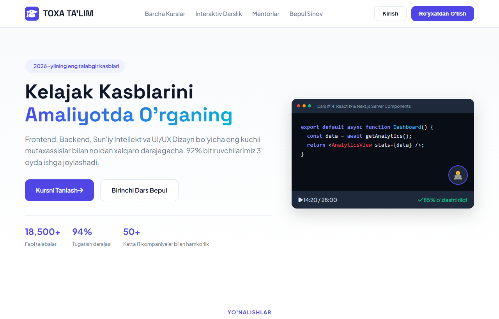

# Toxa Ta'lim (Toxa) — Zamonaviy IT, Sun'iy Intellekt va Dizayn Onlayn Platformasi

Toxa Ta'lim — Frontend (React/Next.js), Python & Sun'iy Intellekt (AI/ML) hamda zamonaviy UI/UX Dizayn sohalari bo'yicha yoshlarni noldan daromadli IT kasblariga o'rgatuvchi zamonaviy interaktiv EdTech ta'lim platformasi maketi (UI).

---

## 📸 Veb-Sahifa Ko'rinishi (Skrinshot)



---

## 🌟 Asosiy Imkoniyatlar va Funksiyalar

1. **Interaktiv Kurslar Katalogi**:
   - Frontend, AI & Data Science va UI/UX Dizayn yo'nalishlari bo'yicha tezkor filtr.
   - Har bir kurs uchun o'quv dasturi davomiyligi, video darslar soni va oylik to'lov.

2. **Jonli Dars Jarayoni Simulyatori**:
   - Dastur kodi muharriri (Code Editor) va mentor videoburchagi interfeysi.

3. **Birinchi Dars Bepul Ro'yxatdan O'tish**:
   - Sinov darsi uchun tezkor ariza qabul qilish tizimi.

---

## 🛠 Texnologiyalar Steki

- **HTML5**: Semantik bloklar va zamonaviy o'quv portali andozasi.
- **Vanilla CSS3**: Yorqin intellektual gradientlar, kartochkalar va moslashuvchan grid.
- **JavaScript (ES6+)**: Interaktiv kurslar filtri va ro'yxatdan o'tish modullari.

---

## 🚀 O'rnatish va Ishga Tushirish

1. Omborni klonlang:
   ```bash
   git clone https://github.com/qodirovtoirbektts-jpg/toxa-onlayn-talim.git
   ```
2. Papkaga kiring:
   ```bash
   cd toxa-onlayn-talim
   ```
3. `index.html` faylini brauzeringizda oching.

---

## 🔗 Jonli Havolalar

- **GitHub Repozitoriyasi**: [https://github.com/qodirovtoirbektts-jpg/toxa-onlayn-talim](https://github.com/qodirovtoirbektts-jpg/toxa-onlayn-talim)
- **Jonli Veb-Sahifa (GitHub Pages)**: [https://qodirovtoirbektts-jpg.github.io/toxa-onlayn-talim/](https://qodirovtoirbektts-jpg.github.io/toxa-onlayn-talim/)

---

## 👤 Muallif

- **Muallif**: Toxa ([qodirovtoirbektts-jpg](https://github.com/qodirovtoirbektts-jpg))
